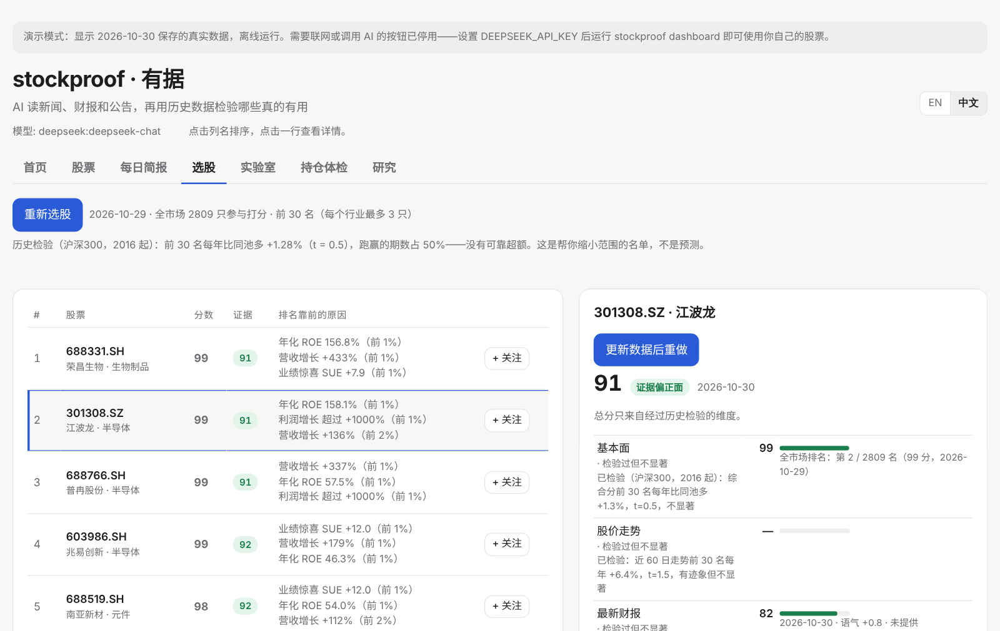
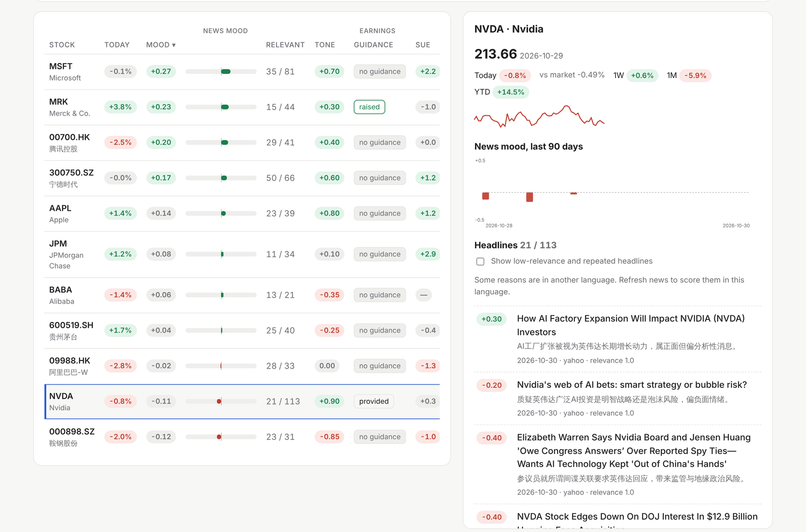
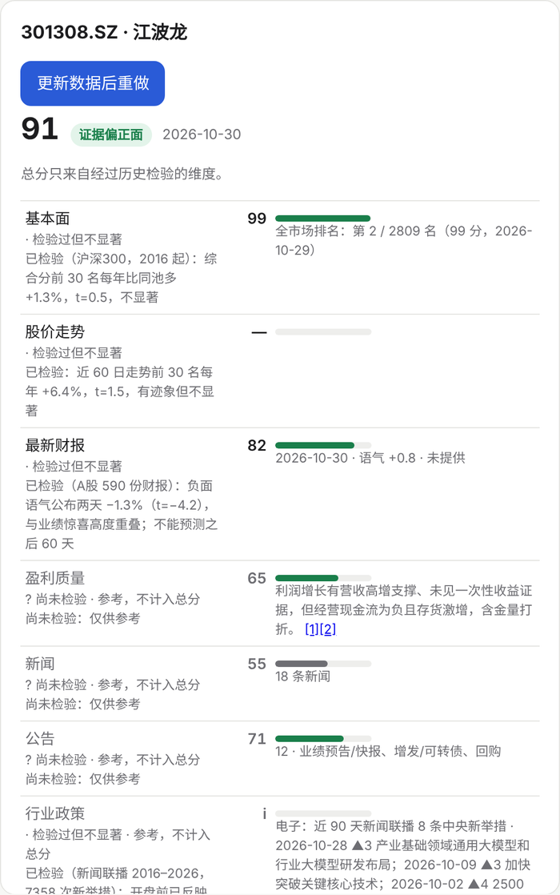
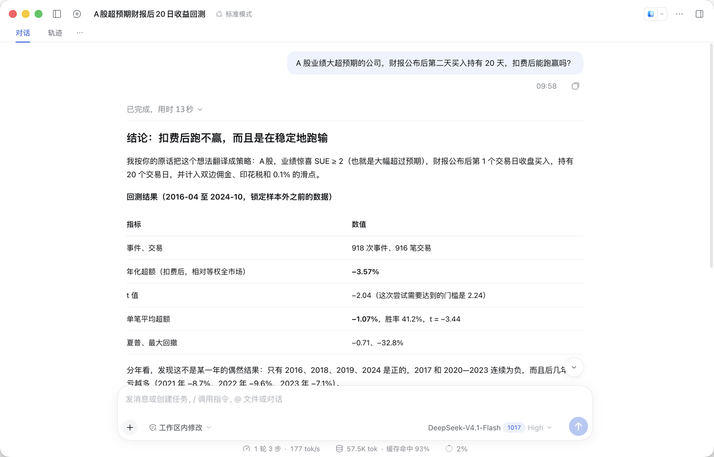
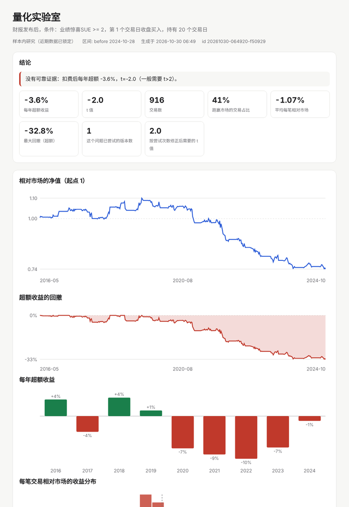
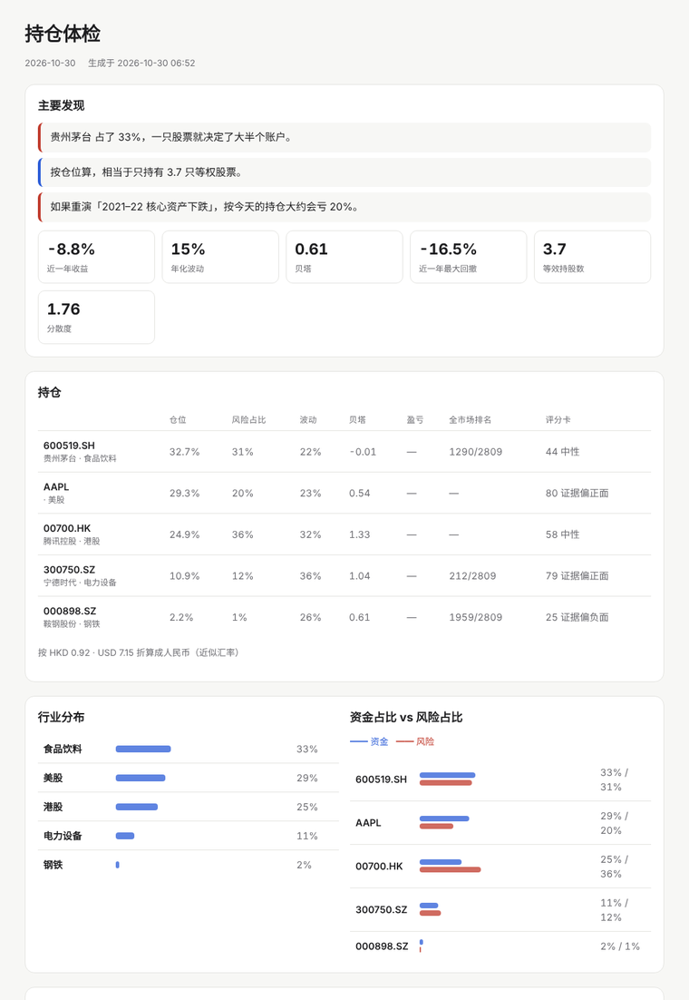
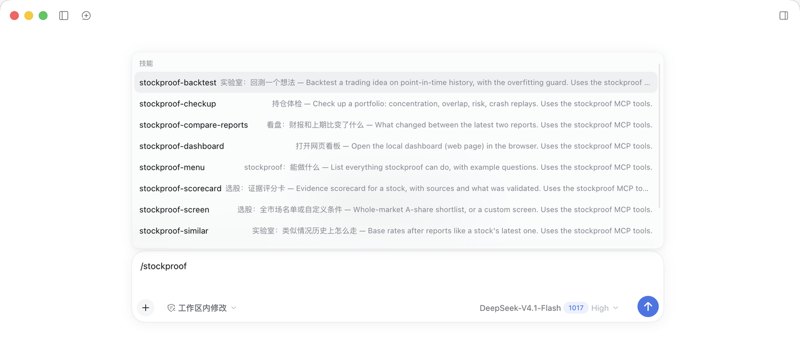

# stockproof · 有据

**An LLM reads stock news, earnings reports and company announcements for you, with every point linked to its
source. A research toolkit then checks each signal against years of prices, and the app tells you what that
check found.** US stocks, China A-shares and Hong Kong. English and 中文.

[](https://github.com/taoqizhang55-code/stockproof/actions/workflows/tests.yml)
 
· [中文说明](README.zh-CN.md)

**Try it in 30 seconds.** The demo runs offline on bundled real data and needs no API key:

```bash
pip install "git+https://github.com/taoqizhang55-code/stockproof"
stockproof demo
```



## What it does

**Daily stock watching**

| | Command | What you get |
|---|---|---|
| **News mood** | `scan` | Headlines for each stock, scored by an LLM for **relevance** and sentiment. Stories about other companies and repeats of the same event are dropped. |
| **Earnings** | `earnings` | The company's own release (SEC 8-K/6-K, Eastmoney for China) read by the LLM: tone, guidance, key points and risks, plus the **earnings surprise (SUE)** from point-in-time EPS. |
| **Announcements** | dashboard | A-share and HK filings are classified by importance (insider selling, regulator letters, buybacks, big contracts and more), and the important ones are summarized. |
| **Why did it move?** | dashboard | For an unusual move, the LLM explains it using only the news, filings and reports published around that day, cites each one, and says so when nothing explains the move. |
| **What changed?** | dashboard | The latest two reports compared: results, outlook, new risks, business and payouts. |
| **Daily digest · calendar · schedule** | `daily`, `calendar`, `schedule` | A daily summary of your watchlist, upcoming reports, and an automatic run every evening (macOS, Windows, Linux), with a desktop notification. |

**Screen and scorecards**

| | Command | What you get |
|---|---|---|
| **Whole-market screen** | `screen` | Every A-share ranked by earnings surprise, growth, ROE and trend, with at most 3 per industry and plain-language reasons. Any stock's rank can be looked up. |
| **Evidence scorecard** | `scorecard` | 0–100 per dimension, with cited evidence, positives and risks. **Each dimension shows whether history tests found it useful, and only tested dimensions count toward the total.** |

**Research and the quant lab**

| | Command | What you get |
|---|---|---|
| **Research** | `research` | Event studies and cost-aware backtests: does any of this predict returns? |
| **Policy signals** | `policy` | 新闻联播 since 2016, read for industry policy: stance and strength on the wording ladder (研究 → 稳步推进 → 加快 → 大力支持). |
| **Quant lab** | `lab` | Backtest **any** idea described as a small spec (earnings, 业绩预告, policy signals, factors) on point-in-time history, with an illustrated report. The last 2 years are **locked** until you confirm once, and every variant you try **raises the bar** for significance. |

**Your portfolio, and AI agents**

| | Command | What you get |
|---|---|---|
| **Portfolio check-up** | `portfolio` | Your holdings on real price history: concentration, holdings that secretly move together, where the risk comes from, and replays of the 2015 / 2018 / 2020 / 2021–22 / 2024 crashes on today's weights. |
| **AI agents** | `mcp` | 23 MCP tools (DeepSeek Harness plugin in `dsh-plugin/`; Claude and Cursor work too). Every feature above can be asked in plain words ("what can you do?" lists them), and the agent can **do research it can't do alone**: run backtests on real data, screen 5,000 stocks, check your portfolio. |

Everything runs in one local web page (`stockproof dashboard`). The **Home** tab shows what you can do, with clickable examples; the **Lab** tab backtests ideas from a form, no JSON needed; the **Portfolio** tab checks up your holdings and remembers them for next time. The first time you use stockproof in DeepSeek Harness, the agent lists everything it can do and suggests trying the dashboard; after that, ask "what can you do?", type `/stockproof` for ready-made requests, or say "open the dashboard". Say "open the dashboard's lab tab" to jump to a page. Running `stockproof` with no arguments prints the same grouped menu, and in DeepSeek Harness typing `/` lists ready-made prompts (check up a portfolio, backtest an idea, why did it move…).

<p align="center"> </p>

### What an LLM can't do alone — and can with stockproof

Ask DeepSeek Harness *"A 股业绩大超预期的公司，财报公布后第二天买入持有 20 天，扣费后能跑赢吗？"*. The model turns the
question into a spec, the lab runs it on ten years of point-in-time A-share data, and a report opens in your browser.
The answer was **no**: −3.6% a year (t = −2.0), positive in 3 of 4 years before 2020 and negative every year from 2020 to 2024. Ask for a variant
and the agent reports that the significance bar went up with the number of tries.



<p align="center"> </p>

In DeepSeek Harness, type `/stockproof` for ten ready-made requests:

<p align="center"></p>

## What the research found

Run on the author's data (2016–2026). Each result is a click away in the Research tab, with t-statistics and caveats.

| Question | Answer |
|---|---|
| Do prices react to earnings surprises? | **Yes, on the day.** Good minus bad SUE: US large caps +1.7% (t = 5.4), CSI 300 +2.0% (t = 17.4). Dated by the 10-Q or legal deadline instead, the reaction is gone, so the real date matters. |
| Does the LLM's reading add anything? | **Yes, for the reaction.** On 472 US releases, tone explains the day's move where SUE does not (tone t = 3.1, SUE t = −0.5; R² 0.004 → 0.035). A-shares: negative tone −1.3% (t = −4.2). |
| …and does it predict what happens next? | **No.** Tone does not predict days 2–61 (t = 0.6). |
| Post-earnings drift? | Gone in US large caps since 2021. Still present in A-shares (+2.2%, t = 2.5), **but long-only it earns +0.3%/yr after costs** (t = 0.2): the drift sits on the short side, which A-share investors can hardly trade. |
| Does a fundamentals screen beat the market? | **No.** Top 30 by the composite score: +1.3%/yr vs the same universe (t = 0.5). Momentum alone: +6.4%/yr (t = 1.5, not significant). |
| Does 新闻联播 policy wording predict industry returns? | **Not tradably.** Over 8,490 new central measures, the strength of the wording is priced in **before the open** (+0.03%, t = 5.3; strongest level +0.12%). Afterwards, supported industries do slightly worse. Backtest: +0.6%/yr (t = 0.4). |

The pattern holds across all of these: public information is priced fast. So stockproof helps you **read and check
evidence faster**. It does not hand you a trading signal, and the app says this wherever it shows a score.

## Principles

- **Cited, not invented.** The LLM may only use the numbered items it is given. Uncited points are dropped, and
  "unexplained" is an allowed answer.
- **Scores carry their track record.** ✓ useful in tests · tested, not significant · ? not tested yet.
- **Point-in-time.** EPS as first reported, real announcement dates, entry after the news. No peeking ahead.
- **Any LLM.** DeepSeek (default), OpenAI, Qwen, a local Ollama model, or any OpenAI-compatible API. Each
  item is read once and cached in SQLite, so daily use costs cents.
- **No paid data.** SEC EDGAR, Yahoo/Google News RSS, Nasdaq, and Eastmoney / Sina / CCTV / Shenwan via AKShare.
- **Local and private.** The dashboard listens on 127.0.0.1 only and refuses requests from other websites. API
  keys are read from the environment and never written to disk.

## Install

Python 3.10+ (3.11+ for China markets).

Works on macOS, Windows and Linux (tested on all three in CI).

```bash
pip install "stockproof[cn,mcp] @ git+https://github.com/taoqizhang55-code/stockproof"
```

Then give it an API key (DeepSeek by default; `stockproof providers` lists the others). US earnings also need a
contact for the SEC.

**macOS / Linux** — add to `~/.zshrc` (or `~/.bashrc`) so it is kept, then open a new terminal:

```bash
export DEEPSEEK_API_KEY="sk-..."
export STOCKPROOF_SEC_CONTACT="Your Name you@example.com"
```

**Windows** — in PowerShell (saved for your user; open a new window afterwards):

```powershell
setx DEEPSEEK_API_KEY "sk-..."
setx STOCKPROOF_SEC_CONTACT "Your Name you@example.com"
```

Then start the dashboard:

```bash
stockproof dashboard
```

Add stocks in the page (`AAPL`, `600519`, `300750`, `00700` …) and click **Refresh news** / **Refresh earnings**.

## Commands

```bash
stockproof dashboard                         # everything in one local page
stockproof scan AAPL 600519 00700 --lang zh  # news mood report
stockproof earnings AAPL MSFT --open         # latest releases read by the LLM, with SUE
stockproof screen --top 30                   # whole-market A-share screen
stockproof screen --backtest --skip-screen   # test the screening rule on history
stockproof scorecard                         # evidence cards for the screen's top 10
stockproof scorecard 600519 NVDA             # …or for any stocks
stockproof research --market cn --open       # earnings event study + backtest (us / cn)
stockproof policy                            # 新闻联播 policy study (first run: a few hours of downloads)
stockproof daily                             # one refresh of the watchlist + daily digest
stockproof schedule --time 21:00             # run `daily` every evening (macOS, Windows, Linux)
stockproof calendar                          # who reports in the next two weeks
stockproof mcp --install-dsh                 # add to DeepSeek Harness on this computer (desktop app too)
stockproof lab caps                          # quant lab: what can be tested here
stockproof lab run '{"type":"earnings","filters":[{"field":"sue","op":">=","value":2}],"hold_days":20}' --open
stockproof lab confirm <id>                  # one shot on the locked holdout
stockproof portfolio "600519 100, 00700 300, AAPL 50"   # portfolio check-up
stockproof demo                              # offline demo, no key
```

Chinese codes can be typed in any common form: `600519`, `600519.SS`, `300750`, `920001`, `700`, `0700.HK`.

## How the pieces work

<details><summary><b>News relevance</b></summary>

A feed for MRK also returns stories about the German Merck KGaA, a feed for GE returns GE HealthCare news, and
NVDA appears in every "stock market today" article (in one scan only 2 of 14 headlines were really about
Nvidia). The model gives each headline a relevance score (0–1) and a sentiment score (−1 to +1), with a reason.
Off-topic stories stay visible but are not counted. When several headlines cover the same event, the model
marks them as duplicates, so the event counts once.
</details>

<details><summary><b>Earnings and SUE</b></summary>

SUE = (this quarter's EPS − the same quarter last year) / standard deviation of the previous 8 such changes,
using EPS as first reported. US quarters come from SEC XBRL, and Q4 = full year − Q1–Q3. A-share reports are
year-to-date totals, so single quarters are derived by subtraction. Announcement dates come from the 8-K
Item 2.02 filing (after 16:00 New York time counts as the next day) or from Eastmoney's 预约披露 actual
disclosure date.
</details>

<details><summary><b>Screen and scorecard</b></summary>

- **Screen:** fundamentals for all ~5,200 A-shares come from Eastmoney's 业绩报表 tables (one download per report period).
  - Filters: no ST stocks, market value ≥ 50亿, at least 2 years listed.
  - Score: the average percentile of five factors.
- **Scorecard:** six dimensions plus industry policy, with one LLM call per stock per day.
  - Earnings quality asks whether growth comes from the core business and is backed by cash, or from one-offs.
  - Announcements count each kind of event once, since one buyback can produce ten filings.
</details>

<details><summary><b>Backtests</b></summary>

- **Entry and holding:** entry at the close after the reaction (earnings) or at the next open (policy), with
  capital split into slots and empty slots holding the market.
- **A-share costs and trading rules:**
  - Commission 0.025% per side, slippage 0.1% per side.
  - Stamp duty on sales: 0.1%, or 0.05% from 2023-08-28.
  - Price limits are respected, at 10% / 20% / 30% depending on the board.
- **Benchmark:** the equal-weighted average of the stocks studied, because today's CSI 300 members beat the
  index by 13% a year (survivorship).
</details>

## Data sources and limits

- **Sources:** SEC EDGAR, Nasdaq, Yahoo/Google News RSS, and Eastmoney, Sina, CCTV and Shenwan via AKShare.
  - These are free, public, unofficial endpoints. They can change or rate-limit you.
  - stockproof slows down, retries, and stops with a clear message when a source refuses.
  - `tools/*_probe.py` checks which sources work from your network.
- **LLM errors:** models can misread. Every point links to the original, so check it.
- **Not investment advice.** The research above is part of the reason this tool doesn't give buy or sell calls.

## Development

```bash
pip install -e ".[dev,mcp]"
pytest              # ~170 offline tests: fake feeds, fake LLM, fake AKShare; no key or network needed
python tools/make_demo.py   # rebuild the demo bundle from your own stockproof_data
```

MIT License.
