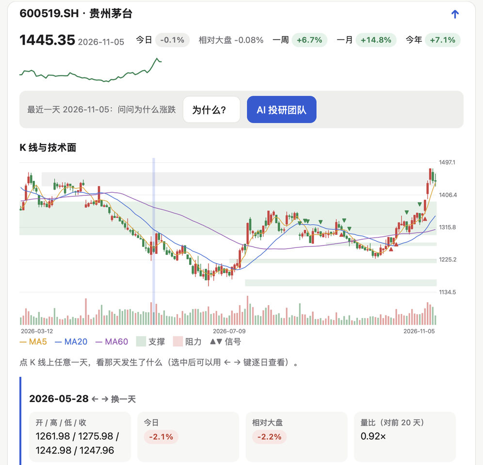
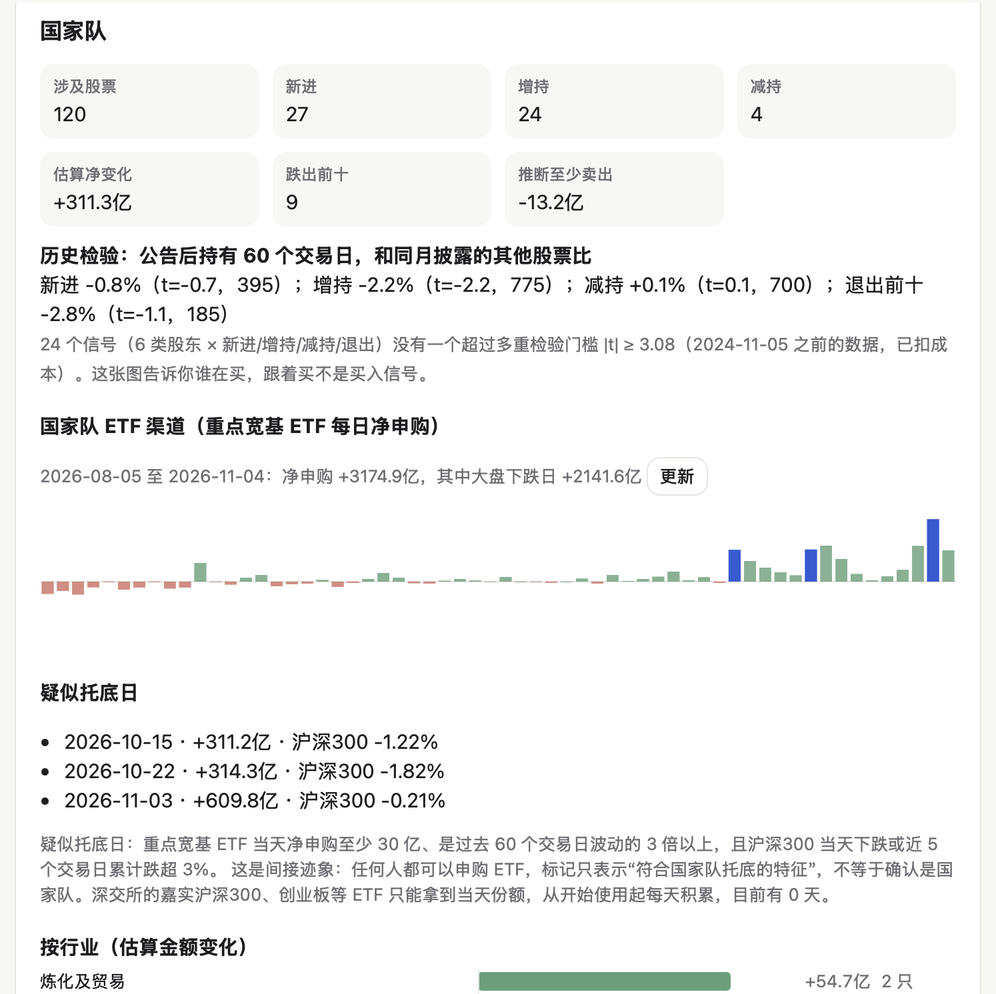
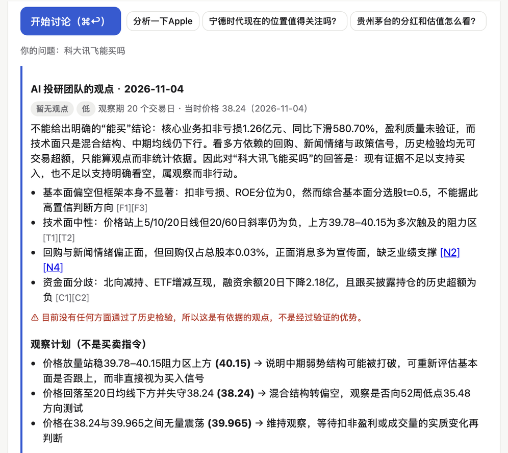
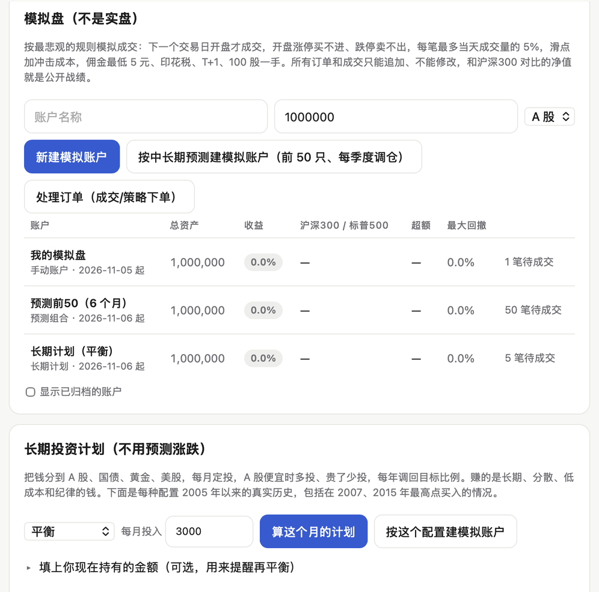

# stockproof · 有据

**让大模型替你读股票新闻、财报和公司公告，每条结论都附原文出处。再用多年历史数据逐一检验这些信号到底有没有用，并在界面上如实标明检验结果。**
支持美股、A 股（沪深北）和港股，中英文界面。

[English](https://github.com/taoqizhang55-code/stockproof/blob/main/README.md)

**30 秒装好，离线体验**（不用 API key，不限时）。演示会打开完整的网页看板，用的是内置的真实数据；只有需要联网或调用 AI 的按钮是停用的：

```bash
pip install stockproof
stockproof demo
```

不需要 GitHub 账号，也不用装 git。国内网络建议用清华镜像，下载更快：
`pip install stockproof -i https://pypi.tuna.tsinghua.edu.cn/simple`

觉得不错？跟着下面的 [10 分钟上手](#10-分钟上手)，从演示走到你自己的股票、一次回测和一次持仓体检。


## 功能

**日常看盘**

| | 命令 | 作用 |
|---|---|---|
| **新闻情绪** | `scan` | AI 判断每条新闻和这家公司**有多相关**、是利好还是利空。张冠李戴的新闻（比如把德国默克的消息算到默沙东头上）和同一事件的重复报道都会被剔除。 |
| **财报解读** | `earnings` | 读公司官方财报原文（美股来自 SEC，A 股和港股来自东方财富）：语气、业绩指引、要点、风险，并计算业绩惊喜 SUE。 |
| **公告监控** | 网页看板 | 按重要程度给 A 股、港股公告分类，比如减持、问询函、回购、中标、重组等；重要公告由 AI 写摘要。 |
| **为什么涨跌？** | 网页看板 | 遇到异动时，只用当天前后的新闻、公告、财报来解释，逐条注明出处；找不到原因就直接说找不到。 |
| **财报对比** | 网页看板 | 最新两期财报相比，业绩、展望、风险、业务、分红有哪些变化。 |
| **每日简报、财报日历、定时运行** | `daily` / `calendar` / `schedule` | 每天汇总关注列表、提醒即将发布的财报、每晚自动更新并弹出通知（Mac、Windows、Linux 都支持）。 |

**选股与评分卡**

| | 命令 | 作用 |
|---|---|---|
| **全市场选股** | `screen` | 全部 A 股按业绩惊喜、营收和利润增长、ROE、走势打分，每个行业最多 3 只，附通俗易懂的理由；任意一只股票都能查排名。 |
| **证据评分卡** | `scorecard` | 每个维度 0–100 分，附出处、利好和风险。**每个维度都标明历史检验结果，只有检验过的维度才计入总分。** |

**研究与量化实验室**

| | 命令 | 作用 |
|---|---|---|
| **研究** | `research` | 事件研究和扣费回测：上面这些信号到底能不能预测股价？ |
| **政策信号** | `policy` | 2016 年以来的新闻联播，按行业判断政策态度，以及措辞落在哪一级（研究 → 稳步推进 → 加快 → 大力支持）。 |
| **量化实验室** | `lab` | 把**任何**交易想法写成策略（财报、业绩预告、政策信号、因子），用不偷看未来的历史数据回测，生成图文报告。最近 2 年数据**锁住**，只能检验一次；每多试一个版本，显著性**门槛自动提高**，防止过拟合。 |

**持仓体检与 AI 智能体**

| | 命令 | 作用 |
|---|---|---|
| **持仓体检** | `portfolio` | 用真实历史股价体检你的持仓：集中度、看似分散其实同涨同跌的股票、风险从哪来，并用今天的仓位重演 2015、2018、2020、2021–22、2024 年的大跌。 |
| **AI 智能体** | `mcp` | 40 个 MCP 工具，含 DeepSeek Harness 插件（`dsh-plugin/`），Claude 和 Cursor 也能用。上面每一项功能都能用中文直接问；问"你能做什么"会列出全部功能。另外让 DeepSeek **做到它原本做不到的事**：用真实数据回测、筛选 5000 只股票、体检你的持仓。 |

**0.4 新增：从看懂到动手，每一步都有记录**

| | 命令 | 作用 |
|---|---|---|
| **一句话直达** | `ask` | 直接说你想干什么（"茅台为什么跌""回测业绩大超预期后买入""在模拟盘买 100 股 600519"），自动调用对应功能。 |
| **K 线 · 点某一天** | 网页看板 / `day` | K 线、均线、MACD/RSI/KDJ、支撑压力区。点任意一根 K 线，看当天涨跌、成交量、新闻和公告。`breakouts` 扫描突破。 |
| **资金地图** | `moneymap` | 43 个季度的前十大流通股东：国家队（汇金、证金、国新）、社保和养老金、北向、保险、QFII、基金。推断披露里看不到的退出；用 ETF 每日申购识别疑似护盘。个股页里也能看。 |
| **AI 投研团队** | `team` | 基本面、技术面、消息面、资金面、风险五位分析师辩论，基金经理拍板并给出价格计划，每个论点都要有出处。每次判断都存档，**到期自动打分**，团队有公开的战绩。 |
| **模拟盘** | `paper` | A 股、港股、美股账户，按真实约束成交：次日开盘价、涨跌停买卖不了、成交量 5% 上限、T+1、整手、佣金（最低 5 元）、印花税。账户可以跟实验室策略、长期预测或长期计划，每晚自动调仓。记录不能改也不能删。 |
| **价格提醒** | `alerts` | 跌破支撑、突破压力、团队给的买点/止损/目标价、模拟盘成交。只在交易日检查（A 股、港股、美股节假日都算了），开着看板时实时盯盘。 |
| **3–12 个月预测** | `forecast` | 用动量、波动、增长、ROE、毛利率、估值给全部 A 股排名，每月只用过去的数据重新训练。每个数字旁边都写着它自己的检验结果（见下）。 |
| **长期计划** | `plan` | 选一种风险偏好（A 股 + 债券 + 黄金 + 美股，或美元版），给出本月买什么、按估值高低调整金额、每年再平衡，并附 20 年历史回放（含 2007 年最高点等四个最差的起点）。 |
| **分享卡片** | `card` | 把团队判断、模拟盘账户或实验室结果做成图片，战绩印在上面。 |

<p align="center"> </p>
<p align="center"> </p>

所有功能都在一个本地网页看板里：`stockproof dashboard`。**首页**列出能做的事，例子点一下就能跑；**实验室**页用表单回测想法，不用写 JSON；**持仓体检**页体检你的持仓，填过的持仓下次自动填好。第一次在 DeepSeek Harness 里用 stockproof 时，DeepSeek 会在对话里列出全部功能，并推荐打开网页看板体验；之后问"你能做什么"、输入 `/stockproof` 选现成问题，或说"打开网页看板"都可以；说"打开网页看板的实验室页"可以直接跳到某一页。命令行直接输入 `stockproof` 会显示同样的分组菜单；在 DeepSeek Harness 里输入 `/` 可以选现成的问题（体检持仓、回测想法、为什么涨跌……）。

### 大模型自己做不到，装了 stockproof 就能做到

在 DeepSeek Harness 里问："A 股业绩大超预期的公司，财报公布后第二天买入持有 20 天，扣费后能跑赢吗？"
DeepSeek 把问题翻译成策略，实验室用十年 A 股数据现场回测，浏览器自动弹出报告。结论是**不能**：每年 −3.6%（t = −2.0），
2020 年前 4 年里有 3 年为正，2020–2024 年每年都是负的。再让它换个条件试，它会提醒你"已经试了 2 个版本，显著性门槛提高到 2.24"。


<p align="center"> </p>

在 DeepSeek Harness 里输入 `/stockproof`，可以选 10 个现成的问题：

<p align="center"></p>

## 研究发现

用作者自己的数据（2005–2026）跑出的结果。网页看板的"研究"页里有完整报告，包括 t 值和注意事项。

| 问题 | 结论 |
|---|---|
| 股价对财报惊喜有反应吗？ | **有，而且集中在公布当天。** 业绩好的组减去业绩差的组：美股大盘股 +1.7%（t = 5.4），沪深 300 +2.0%（t = 17.4）。如果把日期错用成法定截止日，反应就看不到了，所以日期要用真实的披露日。 |
| AI 读财报有额外价值吗？ | **能解释当天的反应。** 美股 472 份财报中，语气能解释当天的涨跌，SUE 解释不了（语气 t = 3.1，SUE t = −0.5）。A 股负面语气的财报公布两天平均 −1.3%（t = −4.2）。 |
| 能预测之后的走势吗？ | **不能。** 对之后第 2–61 天没有预测力（t = 0.6）。 |
| 财报后漂移还在吗？ | 美股大盘股 2021 年后已经消失；A 股仍然存在（+2.2%，t = 2.5），**但只能做多的话，扣除交易成本后每年仅 +0.3%**（t = 0.2）。漂移主要发生在坏消息之后股价继续下跌这一边，A 股很难做空。 |
| 按基本面选股能跑赢吗？ | **不能。** 综合分前 30 名每年比同一股票池多 +1.3%（t = 0.5）；只看走势是 +6.4%（t = 1.5，不显著）。 |
| 新闻联播的政策措辞能预测行业涨跌吗？ | **普通人交易不了。** 在 8490 次中央新举措中，措辞强弱在**开盘前**就已经反映在价格里（+0.03%，t = 5.3；最强一级 +0.12%）。之后，受支持的行业反而略微跑输。回测每年 +0.6%（t = 0.4）。 |

| 跟着国家队、社保买能赚钱吗？ | **不能。** 和同月披露的其他股票比，24 个信号（新进、增持、减持、退出 × 六类股东）持有 60、120、250 天，没有一个能通过多重检验。披露比买入晚 1–4 个月。 |
| 能预测下季度国家队买什么吗？ | **能，但不赚钱。** 前 20 名命中率是平均的 2.1 倍（AUC 0.64）；在披露前买入，扣费后每季度 −0.3%。 |
| 3–12 个月的涨跌能预测吗？ | **以前能，最近不行。** 用 20 年全市场数据（5224 只股票，含退市），前 10% 持有 6 个月，扣费后每年比平均股票多 +6.7%（t 2.8）。但在锁定的 2024-11→2026 年亏了：924 行情后，低波动和便宜这两个信号失效。看板上写的是"历史上通过，近两年失效"。 |
| 长期投资什么真的有用？ | **分散。** 平衡型计划（A 股、债券、黄金、美股）从 2007 年最高点开始：每年 +6.7%，最大回撤 −30%。同一天只买沪深 300：每年 −1.7%，最大回撤 −71%。 |

这些结论的共同点是：公开信息会被市场很快消化。所以 stockproof 的定位是**帮你更快地阅读和核实证据**，给出的每个预测都附上自己的检验结果。它不会替你下真实的单：可以先在模拟盘上练，真金白银由你自己决定。

## 设计原则

- **有出处，不编造：** AI 只能使用编了号的证据，注明不了出处的观点会被自动删掉；"找不到原因"也是允许的回答。
- **分数带着检验记录：** ✓ 历史检验有效 · 检验过但不显著 · ? 尚未检验。
- **不偷看未来：** 每股收益用首次公布的数字，日期用真实披露日，买入时点在消息发布之后。
- **任意大模型：** 默认 DeepSeek，也支持 OpenAI、通义千问、本地 Ollama 和任何 OpenAI 兼容接口。每条内容只读一次并缓存，日常使用一天只要几分钱。
- **不用付费数据：** SEC、Nasdaq、Yahoo 和 Google 新闻 RSS，以及通过 AKShare 获取的东方财富、新浪、央视、申万数据。
- **本地运行，保护隐私：** 网页看板只在本机（127.0.0.1）运行，拒绝其他网站发来的请求；API key 只从环境变量读取，不写进任何文件。

## 安装

需要 Python 3.10 以上（A 股和港股需要 3.11 以上）。

Mac、Windows、Linux 都能用，三个系统都有自动测试。

```bash
pip install "stockproof[cn,mcp]"
```

然后设置 API key（默认用 DeepSeek，`stockproof providers` 可以查看其他模型）。只有美股财报需要第二行的联系方式（SEC 要求）。

**Mac / Linux**：把下面两行加到 `~/.zshrc`（或 `~/.bashrc`）里，这样会一直有效，然后重新打开终端：

```bash
export DEEPSEEK_API_KEY="sk-..."
export STOCKPROOF_SEC_CONTACT="你的名字 you@example.com"
```

**Windows**：在 PowerShell 里运行（会为当前用户保存，之后重新打开窗口）：

```powershell
setx DEEPSEEK_API_KEY "sk-..."
setx STOCKPROOF_SEC_CONTACT "你的名字 you@example.com"
```

最后打开网页看板：

```bash
stockproof dashboard
```

在网页里添加股票（`600519`、`300750`、`00700`、`AAPL`……），然后点"更新新闻"和"更新财报"。

## 10 分钟上手

先完成上面的[安装](#安装)并设置好 API key，然后：

1. **逛一遍演示（2 分钟）。** 运行 `stockproof demo`，把每个标签页点开看看。首页列出了能做的事，例子点一下就能跑。
2. **加你自己的股票（3 分钟）。** 运行 `stockproof dashboard` → 股票页 → 输入几个代码（`600519, 00700, AAPL`）→ **添加** → 点**更新新闻**，再点**更新财报**。第一次更新每只股票大约要一分钟。点任意一行，可以看新闻、财报解读和公告；遇到异动，点旁边的**为什么？**。
3. **检验一个想法（2 分钟）。** 实验室页 → 点一个模板，比如"业绩大超预期后买入，持有 20 天" → **开始回测**。看完结论，改一个条件再跑一次：每多试一个版本，显著性门槛就会提高。
4. **体检你的持仓（1 分钟）。** 持仓体检页 → 填入持仓（`600519 100, AAPL 50`）→ **开始体检**。报告会告诉你仓位集中不集中、哪些股票其实同涨同跌，以及按今天的仓位，历史上几次大跌会亏多少。
5. **用中文直接问（1 分钟，可选）。** 运行 `stockproof mcp --install-dsh`，重启 DeepSeek Harness，输入 `/stockproof`，或者问"你能做什么"。
6. **每天自动更新（1 分钟）。** 运行 `stockproof schedule --time 21:00`，每晚自动更新关注列表并生成每日简报（Mac、Windows、Linux 都支持）。

## 常用命令

```bash
stockproof dashboard                         # 打开网页看板
stockproof screen --top 30                   # 全市场选股
stockproof screen --backtest --skip-screen   # 用历史数据检验选股规则
stockproof scorecard                         # 给选股名单前 10 名生成证据评分卡
stockproof scorecard 600519 000898           # 也可以指定任意股票
stockproof research --market cn --open       # A 股财报事件研究和回测
stockproof policy                            # 新闻联播政策研究（第一次需要下载几个小时）
stockproof schedule --time 21:00             # 每晚自动更新（Mac、Windows、Linux 都支持）
stockproof mcp --install-dsh                 # 一条命令装进 DeepSeek Harness（含桌面版，任何电脑）
stockproof lab caps                          # 量化实验室：能检验哪些想法
stockproof lab confirm <id>                  # 在锁定的近两年数据上检验一次
stockproof portfolio "600519 100, 00700 300, AAPL 50"   # 持仓体检
stockproof demo                              # 离线演示
stockproof ask "茅台为什么跌"                # 一句话调用对应功能
stockproof team 600519                       # AI 投研团队的判断（--record 看战绩）
stockproof day 600519 2024-09-30             # 某一天发生了什么
stockproof moneymap --ticker 600519          # 谁在持有：国家队、社保、北向……
stockproof moneymap --research               # 跟着他们买能赚钱吗？
stockproof forecast 600519                   # 3/6/12 个月预测和检验结果
stockproof plan --profile balanced --monthly 5000   # 长期计划：本月买什么
stockproof paper new --name "我的模拟盘" --cash 100000   # 模拟盘（--market cn/hk/us）
stockproof paper buy <账户> 600519 --shares 100
stockproof paper forecast --horizon 6m --n 50        # 跟着预测自动调仓的账户
stockproof paper show <账户>                 # 持仓、对比基准的盈亏、成交记录
stockproof alerts                            # 价格提醒（--watch 持续盯盘）
stockproof card team <call_id> --open        # 分享卡片
```

## 数据与局限

- 数据接口是免费、公开但非官方的，可能变化或限流。stockproof 会自动放慢、重试，被拒绝时会给出明确提示后停止。
- AI 可能读错，每条结论都附原文链接，请以原文为准。
- **模拟盘不等于实盘。** 按次日开盘价和成交量上限撮合，真实成交可能更差；`stockproof paper gap` 对比模拟盘和回测的差距。港股每手按 100 股估算。
- **预测在衰减。** 2010–24 年通过检验，锁定的 2024-11→2026 年失效。美股预测（60 只大盘股，只用价格特征）没有通过任何检验。
- **不构成投资建议。** 没有接入券商，不会自动用真钱交易。

MIT 许可证。
