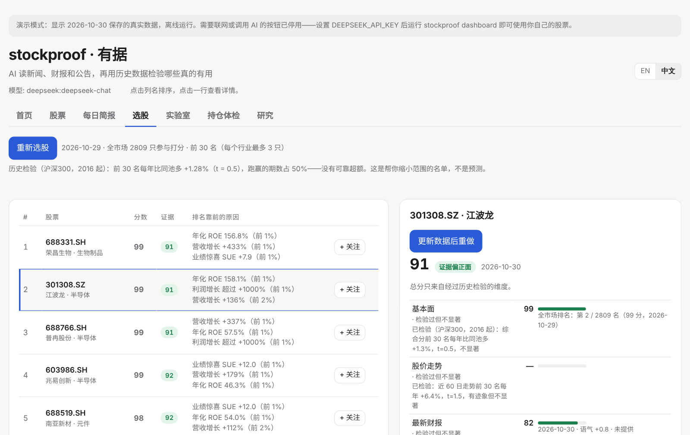
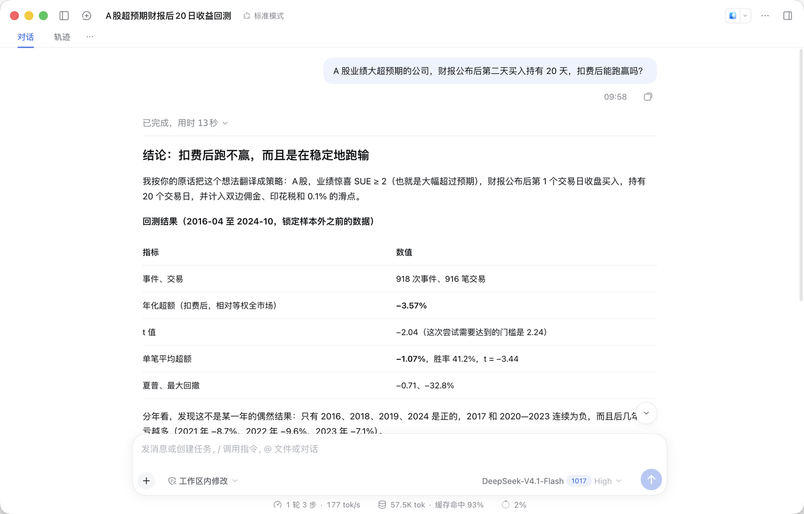
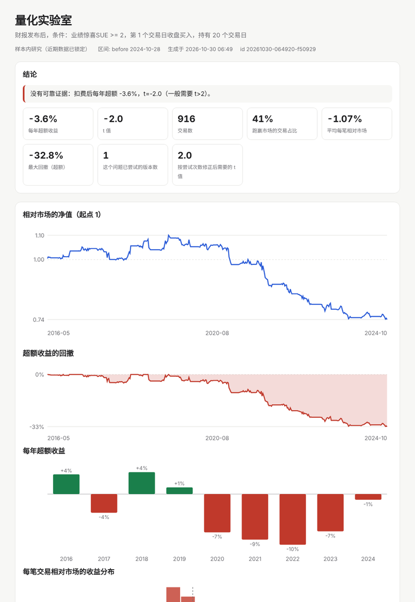
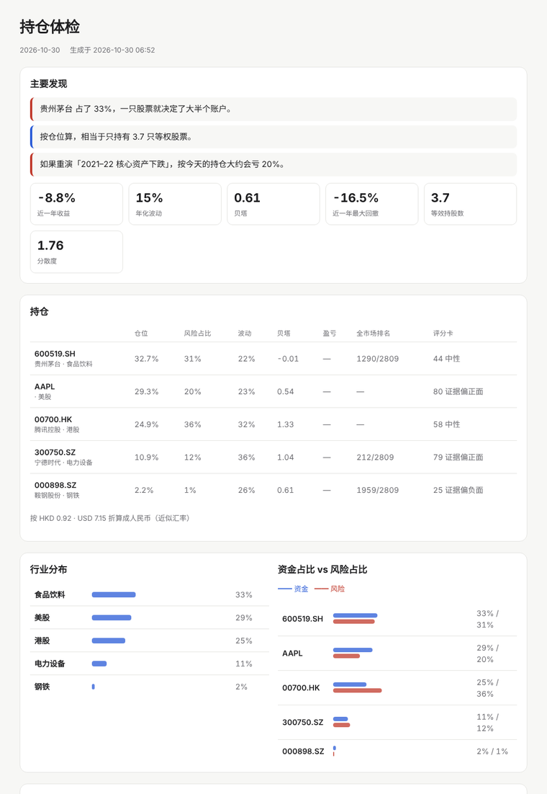
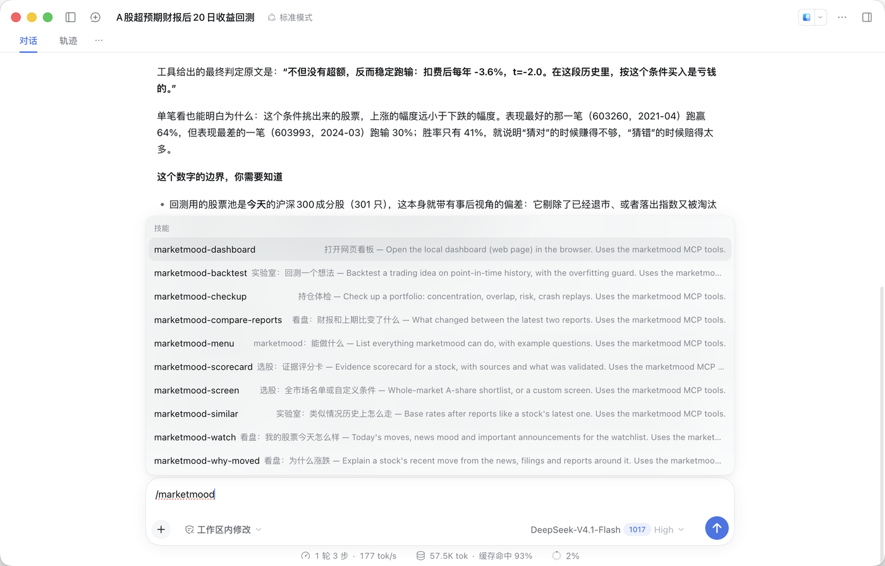

# marketmood

**让大模型替你读股票新闻、财报和公司公告，每条结论都附原文出处。再用多年历史数据逐一检验这些信号到底有没有用，并在界面上如实标明检验结果。**
支持美股、A 股（沪深北）和港股，中英文界面。

[English](README.md)

**30 秒试用。** 演示内置真实数据，离线运行，不需要 API key：

```bash
pip install "git+https://github.com/taoqizhang55-code/marketmood"
marketmood demo
```



## 功能

**日常看盘**

| | 命令 | 作用 |
|---|---|---|
| **新闻情绪** | `scan` | AI 判断每条新闻和这家公司**有多相关**、是利好还是利空。张冠李戴的新闻（比如把德国默克的消息算到默沙东头上）和同一事件的重复报道都会被剔除。 |
| **财报解读** | `earnings` | 读公司官方财报原文（美股来自 SEC，A 股和港股来自东方财富）：语气、业绩指引、要点、风险，并计算业绩惊喜 SUE。 |
| **公告监控** | 网页看板 | 按重要程度给 A 股、港股公告分类，比如减持、问询函、回购、中标、重组等；重要公告由 AI 写摘要。 |
| **为什么涨跌？** | 网页看板 | 遇到异动时，只用当天前后的新闻、公告、财报来解释，逐条注明出处；找不到原因就直接说找不到。 |
| **财报对比** | 网页看板 | 最新两期财报相比，业绩、展望、风险、业务、分红有哪些变化。 |
| **每日简报、财报日历、定时运行** | `daily` / `calendar` / `schedule` | 每天汇总关注列表、提醒即将发布的财报、每晚自动更新（macOS）。 |

**选股与评分卡**

| | 命令 | 作用 |
|---|---|---|
| **全市场选股** | `screen` | 全部 A 股按业绩惊喜、营收和利润增长、ROE、走势打分，每个行业最多 3 只，附通俗易懂的理由；任意一只股票都能查排名。 |
| **证据评分卡** | `scorecard` | 每个维度 0–100 分，附出处、利好和风险。**每个维度都标明历史检验结果，只有检验过的维度才计入总分。** |

**研究与量化实验室**

| | 命令 | 作用 |
|---|---|---|
| **研究** | `research` | 事件研究和扣费回测：上面这些信号到底能不能预测股价？ |
| **政策信号** | `policy` | 2016 年以来的新闻联播，按行业判断政策态度，以及措辞落在哪一级（研究 → 稳步推进 → 加快 → 大力支持）。 |
| **量化实验室** | `lab` | 把**任何**交易想法写成策略（财报、业绩预告、政策信号、因子），用不偷看未来的历史数据回测，生成图文报告。最近 2 年数据**锁住**，只能检验一次；每多试一个版本，显著性**门槛自动提高**，防止过拟合。 |

**持仓体检与 AI 智能体**

| | 命令 | 作用 |
|---|---|---|
| **持仓体检** | `portfolio` | 用真实历史股价体检你的持仓：集中度、看似分散其实同涨同跌的股票、风险从哪来，并用今天的仓位重演 2015、2018、2020、2021–22、2024 年的大跌。 |
| **AI 智能体** | `mcp` | 23 个 MCP 工具，含 DeepSeek Harness 插件（`dsh-plugin/`），Claude 和 Cursor 也能用。上面每一项功能都能用中文直接问；问"你能做什么"会列出全部功能。另外让 DeepSeek **做到它原本做不到的事**：用真实数据回测、筛选 5000 只股票、体检你的持仓。 |

所有功能都在一个本地网页看板里：`marketmood dashboard`。**首页**列出能做的事，例子点一下就能跑；**实验室**页用表单回测想法，不用写 JSON；**持仓体检**页体检你的持仓，填过的持仓下次自动填好。第一次在 DeepSeek Harness 里用 marketmood 时，DeepSeek 会在对话里列出全部功能，并推荐打开网页看板体验；之后问"你能做什么"、输入 `/marketmood` 选现成问题，或说"打开网页看板"都可以；说"打开网页看板的实验室页"可以直接跳到某一页。命令行直接输入 `marketmood` 会显示同样的分组菜单；在 DeepSeek Harness 里输入 `/` 可以选现成的问题（体检持仓、回测想法、为什么涨跌……）。

### 大模型自己做不到，装了 marketmood 就能做到

在 DeepSeek Harness 里问："A 股业绩大超预期的公司，财报公布后第二天买入持有 20 天，扣费后能跑赢吗？"
DeepSeek 把问题翻译成策略，实验室用十年 A 股数据现场回测，浏览器自动弹出报告。结论是**不能**：每年 −3.6%（t = −2.0），
2020 年前 4 年里有 3 年为正，2020–2024 年每年都是负的。再让它换个条件试，它会提醒你"已经试了 2 个版本，显著性门槛提高到 2.24"。



<p align="center"> </p>

在 DeepSeek Harness 里输入 `/marketmood`，可以选 10 个现成的问题：

<p align="center"></p>

## 研究发现

用作者自己的数据（2016–2026）跑出的结果。网页看板的"研究"页里有完整报告，包括 t 值和注意事项。

| 问题 | 结论 |
|---|---|
| 股价对财报惊喜有反应吗？ | **有，而且集中在公布当天。** 业绩好的组减去业绩差的组：美股大盘股 +1.7%（t = 5.4），沪深 300 +2.0%（t = 17.4）。如果把日期错用成法定截止日，反应就看不到了，所以日期要用真实的披露日。 |
| AI 读财报有额外价值吗？ | **能解释当天的反应。** 美股 472 份财报中，语气能解释当天的涨跌，SUE 解释不了（语气 t = 3.1，SUE t = −0.5）。A 股负面语气的财报公布两天平均 −1.3%（t = −4.2）。 |
| 能预测之后的走势吗？ | **不能。** 对之后第 2–61 天没有预测力（t = 0.6）。 |
| 财报后漂移还在吗？ | 美股大盘股 2021 年后已经消失；A 股仍然存在（+2.2%，t = 2.5），**但只能做多的话，扣除交易成本后每年仅 +0.3%**（t = 0.2）。漂移主要发生在坏消息之后股价继续下跌这一边，A 股很难做空。 |
| 按基本面选股能跑赢吗？ | **不能。** 综合分前 30 名每年比同一股票池多 +1.3%（t = 0.5）；只看走势是 +6.4%（t = 1.5，不显著）。 |
| 新闻联播的政策措辞能预测行业涨跌吗？ | **普通人交易不了。** 在 8490 次中央新举措中，措辞强弱在**开盘前**就已经反映在价格里（+0.03%，t = 5.3；最强一级 +0.12%）。之后，受支持的行业反而略微跑输。回测每年 +0.6%（t = 0.4）。 |

这些结论的共同点是：公开信息会被市场很快消化。所以 marketmood 的定位是**帮你更快地阅读和核实证据**，而不是给你一个买卖信号。看板上凡是出现分数的地方，都会如实写明这一点。

## 设计原则

- **有出处，不编造：** AI 只能使用编了号的证据，注明不了出处的观点会被自动删掉；"找不到原因"也是允许的回答。
- **分数带着检验记录：** ✓ 历史检验有效 · 检验过但不显著 · ? 尚未检验。
- **不偷看未来：** 每股收益用首次公布的数字，日期用真实披露日，买入时点在消息发布之后。
- **任意大模型：** 默认 DeepSeek，也支持 OpenAI、通义千问、本地 Ollama 和任何 OpenAI 兼容接口。每条内容只读一次并缓存，日常使用一天只要几分钱。
- **不用付费数据：** SEC、Nasdaq、Yahoo 和 Google 新闻 RSS，以及通过 AKShare 获取的东方财富、新浪、央视、申万数据。
- **本地运行，保护隐私：** 网页看板只在本机（127.0.0.1）运行，拒绝其他网站发来的请求；API key 只从环境变量读取，不写进任何文件。

## 安装

需要 Python 3.10 以上（A 股和港股需要 3.11 以上）。

```bash
pip install "marketmood[cn,mcp] @ git+https://github.com/taoqizhang55-code/marketmood"
export DEEPSEEK_API_KEY="sk-..."
export MARKETMOOD_SEC_CONTACT="你的名字 you@example.com"   # 只有美股财报需要（SEC 要求）
marketmood dashboard
```

在网页里添加股票（`600519`、`300750`、`00700`、`AAPL`……），然后点"更新新闻"和"更新财报"。

## 常用命令

```bash
marketmood dashboard                         # 打开网页看板
marketmood screen --top 30                   # 全市场选股
marketmood screen --backtest --skip-screen   # 用历史数据检验选股规则
marketmood scorecard                         # 给选股名单前 10 名生成证据评分卡
marketmood scorecard 600519 000898           # 也可以指定任意股票
marketmood research --market cn --open       # A 股财报事件研究和回测
marketmood policy                            # 新闻联播政策研究（第一次需要下载几个小时）
marketmood schedule --time 21:00             # 每晚自动更新（macOS）
marketmood mcp --install-dsh                 # 一条命令装进 DeepSeek Harness（含桌面版，任何电脑）
marketmood lab caps                          # 量化实验室：能检验哪些想法
marketmood lab confirm <id>                  # 在锁定的近两年数据上检验一次
marketmood portfolio "600519 100, 00700 300, AAPL 50"   # 持仓体检
marketmood demo                              # 离线演示
```

## 数据与局限

- 数据接口是免费、公开但非官方的，可能变化或限流。marketmood 会自动放慢、重试，被拒绝时会给出明确提示后停止。
- AI 可能读错，每条结论都附原文链接，请以原文为准。
- **不构成投资建议。** 上面的研究结论，正是这个工具不给买卖建议的原因之一。

MIT 许可证。
